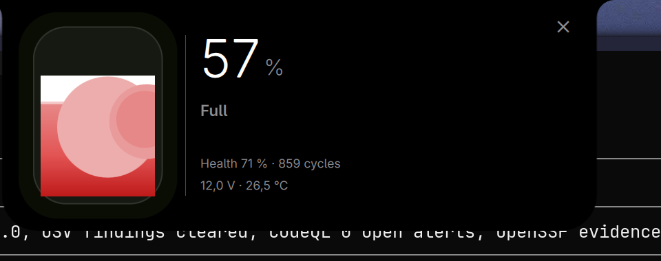

# Battery — k4 plugin

Your laptop battery as **real liquid** in the [k4](https://github.com/k4ditano/k4) island.



## What it does

**The view** — click the pill indicator or press `SUPER+SHIFT+B`:

- A glass capsule whose liquid level *is* your charge, with three
  staggered sloshing waves, a meniscus line and a depth gradient.
- The liquid pours in from empty every time you open it.
- **Charging**: a glowing lightning bolt floats above the liquid and
  sinks as it fills; bubbles rise through it; the capsule breathes.
- **Low battery**: the alarm glyph pulses red over the liquid and the
  whole capsule throbs.
- **Full**: a glint periodically sweeps across the glass.
- Live readout: %, status, time to full/empty, **health %**, cycle
  count, volts and temperature.

**The choreography** — the island itself gets physical:

| Moment | What happens |
|---|---|
| 🔌 Plug in | island gets **yanked** (`tiron`), bar flashes green, `power-plug` sound |
| 🔌 Unplug | island **shakes**, bar flashes amber, `power-unplug` sound |
| 🪫 Below threshold (15%) | strong shake, bar tints red 8 s, red capsule grows from the pill, system notification |
| 🔋 Full | green tint + notification |

Everything is toggleable in **Settings → Battery** (threshold, gestures,
sounds, tint) and persisted.

## Install

The plugin folder must be named `battery` (it must match the plugin id):

```sh
git clone https://github.com/mrofisr/hyprland ~/repos/hyprland
ln -s ~/repos/hyprland/k4-plugins/battery ~/.config/k4/plugins/battery
quickshell ipc -p ~/.config/quickshell/k4/shell.qml call k4 pluginEnable battery
```

Requires k4 `>=1.1.0`.

**Permissions**: `procesos` (one `cat` of `/sys/class/power_supply` files
every 10 s — nothing that can hang) and `sonido` (desktop plug/unplug
sounds). It reads no secrets and writes only its own settings file. This
is **not a sandbox**: a k4 plugin runs inside the bar's process.

## Shortcut

The plugin declares the `k4:battery` global shortcut; bind it in your
Hyprland config (this repo's `binds.lua` already does):

```lua
hl.bind("SUPER + SHIFT + B", hl.dsp.global("k4:battery"))
```

## IPC

```sh
quickshell ipc -p ~/.config/quickshell/k4/shell.qml call k4.battery <fn>
```

- `state` — everything read, as JSON
- `open` / `close` — the liquid view
- `simulate 9` — show a made-up % and run the **real** alarm path
  (watch the choreography without draining the battery)
- `restore` — back to the real `/sys` reading

## Files

- `BatteryPlugin.qml` — state, polling, events, pill/capsule, settings, IPC
- `BatteryView.qml` — the liquid animation
- `plugin.json` — manifest
